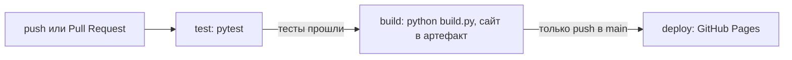

# Задача 19: Упрощённый markdown→HTML для заметок лекций

**Студент:** Ленец Е.

[](https://github.com/qqZeR002/lab6-cicd-pipeline/actions/workflows/ci.yml)

**Постановка.** Минимальный конвертер подмножества Markdown (заголовки, списки, код). Тесты на фикстурах. CI; CD — публикация сконвертированных заметок на Pages.

- Опубликованные заметки: https://qqzer002.github.io/lab6-cicd-pipeline/
- Прогоны пайплайна: https://github.com/qqZeR002/lab6-cicd-pipeline/actions

## Структура проекта

| Файл / папка | Что это |
|--------------|---------|
| `md2html.py` | конвертер, функция `convert(text)` |
| `build.py` | собирает сайт: `notes/*.md` → `public/*.html` и `index.html` |
| `notes/` | заметки лекций в Markdown (их и публикуем) |
| `tests/test_md2html.py` | тесты (pytest) |
| `tests/fixtures/` | фикстуры: пары `имя.md` и ожидаемый `имя.html` |
| `.github/workflows/ci.yml` | пайплайн GitHub Actions |

## Что умеет конвертер

| Markdown | HTML |
|----------|------|
| `# Заголовок` … `###### Заголовок` | `<h1>` … `<h6>` |
| `- пункт` или `* пункт` | `<ul><li>` |
| `1. пункт` | `<ol><li>` |
| блок в тройных обратных кавычках | `<pre><code>` |
| `` `код` `` в строке | `<code>` |
| обычный текст | `<p>` |

Символы `<`, `>`, `&` экранируются, поэтому HTML-теги из заметки не выполняются. Жирный шрифт, ссылки, картинки, вложенные списки и таблицы не поддерживаются: это не входит в подмножество.

## Как запустить локально

```bash
python3 -m venv .venv
source .venv/bin/activate        # Windows: .venv\Scripts\activate
pip install -r requirements.txt

pytest -v            # тесты, должно быть 26 passed
python build.py      # сборка сайта в папку public/
```

После сборки можно открыть `public/index.html` в браузере.

## Тесты

Тесты на фикстурах: для каждого файла `tests/fixtures/имя.md` рядом лежит ожидаемый `имя.html`. Тест конвертирует `.md` и сравнивает со вторым файлом строка в строку. Фикстур четыре: `headings`, `lists`, `code`, `mixed`.

Кроме них есть отдельные проверки: все 6 уровней заголовков, семь решёток и `#тег` без пробела остаются текстом, список закрывается перед заголовком, внутри блока кода `#` и `-` не разбираются, незакрытый блок кода в конце файла, экранирование HTML, пустой ввод, сборка сайта во временную папку.

## Как устроен CI/CD

Пайплайн описан в `.github/workflows/ci.yml`, в нём три стадии (job):



| Стадия | Когда запускается | Что делает |
|--------|-------------------|------------|
| `test` (CI) | каждый `push` в `main` и каждый Pull Request | ставит Python 3.12 и зависимости, запускает `pytest -v`. Если хоть один тест упал, пайплайн красный и дальше не идёт |
| `build` | только после успешного `test` (`needs: test`) | запускает `python build.py`, папку `public/` сохраняет как артефакт |
| `deploy` (CD) | только после `build` и **только при push в ветку `main`** | публикует артефакт на GitHub Pages |

Ограничение по ветке задано условием `if: github.ref == 'refs/heads/main' && github.event_name == 'push'`. В Pull Request тесты и сборка проходят, а публикации нет.

Секретов в проекте нет. Для публикации используется встроенный токен GitHub с правами `pages: write` и `id-token: write`, они выданы только стадии `deploy`.

**Что считается успешным деплоем:** стадия `deploy` зелёная и по адресу https://qqzer002.github.io/lab6-cicd-pipeline/ открывается список из трёх заметок.

## Как проверить статус CI

- бейдж вверху этого README (зелёный `passing` или красный `failing`);
- вкладка **Actions** в репозитории;
- из терминала: `gh run list --limit 5`.

Проверку того, что пайплайн действительно падает на сломанном тесте, я сделал в отдельном Pull Request (ссылка в разделе ниже).

## Проверка, что CI ловит ошибки

Чтобы убедиться, что пайплайн не только зелёный, я специально сломал конвертер в ветке `demo-broken-heading`: разрешил заголовки из семи решёток (`#{1,7}` вместо `#{1,6}`) и открыл Pull Request.

- Pull Request: https://github.com/qqZeR002/lab6-cicd-pipeline/pull/1
- Прогон: https://github.com/qqZeR002/lab6-cicd-pipeline/actions/runs/43442443907

Результат прогона:

| Стадия | Итог |
|--------|------|
| `test` | failure (упали тест на фикстуре `headings` и `test_seven_hashes_is_paragraph`) |
| `build` | skipped |
| `deploy` | skipped |

Сломанный код на Pages не попал. Pull Request закрыт без слияния, ветка оставлена для примера.

Первый прогон на `main` (все три стадии зелёные): https://github.com/qqZeR002/lab6-cicd-pipeline/actions/runs/43442273509
